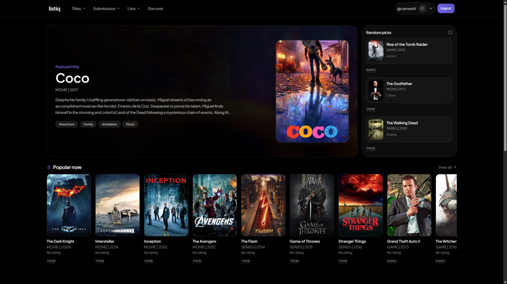

# Bohdan Kondratskyi — macOS Portfolio

A personal developer portfolio you can explore like a macOS desktop. Open a project folder, read its notes, preview a screenshot, or launch the live app from Finder.

[Explore the desktop](#explore-the-desktop) · [Projects](#projects) · [Run locally](#run-locally) · [How it works](#how-it-works) · [Add a project](#add-a-project) · [Deploy](#deploy)

## Explore the desktop

The portfolio is designed for desktop and tablet screens. Start with a folder on the desktop, or open **Projects** in the menu bar to browse Finder.

| Where | What you'll find |
| --- | --- |
| **Finder → Work / My Apps** | Project folders with text notes, screenshots, and links to demos or source code. |
| **Finder → About me** | A portrait in `me.png` and a short introduction in `about-me.txt`. |
| **Resume** | A preview of the first page and a button to download the full PDF. |
| **Gallery** | A photo collection with a separate image preview window. |
| **Skills** | A Terminal-style overview of the technologies I use. |
| **Contact** | Links to my social profiles. |
| **Browser** | A playable Snake game inside a Safari-inspired window. |

## Projects

| Project | What it does |
| --- | --- |
| [ListIQ](https://listiq-topaz.vercel.app/) | A media library for tracking what you watch, read, and play, with recommendations, reviews, and shareable lists. |
| Messenger Clone | A real-time chat app with authentication, notifications, and live message sync via Pusher. |
| MERN Food Delivery App | A full-stack food ordering app with Stripe and order tracking. |
| BEM Landing | A responsive HTML and SCSS landing page organized with BEM. |
| Python RPG Creator | An experiment in object-oriented character creation and JSON export. |

<details>
<summary>Preview the ListIQ dashboard</summary>



</details>

## Run locally

Use Node.js **22.12+** (or a newer LTS release) and npm. The portfolio is a static React app: local setup needs no API keys, `.env` file, or database.

```bash
git clone https://github.com/cementix/cementixx_macos_portfolio.git
cd cementixx_macos_portfolio
npm ci
npm run dev
```

Open `http://localhost:5173`, or use the URL Vite prints if the default port is busy.

| Command | What it does |
| --- | --- |
| `npm run dev` | Starts the Vite server with hot reload. |
| `npm run lint` | Checks the source with ESLint. |
| `npm run build` | Builds the production site in `dist/`. |
| `npm run preview` | Serves the production build locally after `npm run build`. |

## How it works

**React and Vite** render the desktop as a single page. **Tailwind CSS** and `src/index.css` style the shell and windows. **GSAP** animates the desktop, dock, and windows and makes folders and windows draggable. **Zustand with Immer** manages the active Finder location and open windows in memory. **React PDF** renders the résumé.

| Path | Responsibility |
| --- | --- |
| [`src/App.jsx`](src/App.jsx) | Assembles the desktop shell and mounts the available windows. |
| [`src/components/`](src/components/) | Desktop folders, menu bar, dock, window controls, welcome screen, and Snake. |
| [`src/windows/`](src/windows/) | Finder, text and image previews, résumé, contacts, gallery, Terminal, and Browser. |
| [`src/constants/index.js`](src/constants/index.js) | The virtual filesystem, project entries, dock items, skills, and links. |
| [`src/store/`](src/store/) | Tracks the active Finder location, window payloads, visibility, and stacking order. |
| [`src/hoc/WindowWrapper.jsx`](src/hoc/WindowWrapper.jsx) | Shares window visibility, animation, dragging, and focus behavior across apps. |
| [`public/`](public/) | Static assets served as-is, including icons, project images, wallpaper, and the résumé PDF. |

Clicking a desktop folder selects it in the location store and opens Finder. The desktop, the Work view, and the My Apps sidebar all read from `locations.work.children`. Inside Finder, folders change the active location, text and image files pass their metadata to a preview window, PDFs open the résumé viewer, and URLs open in a browser tab. Window and Finder state reset when the page reloads.

## Add a project

1. Put the screenshot in `public/images/`, for example `public/images/my-project.png`.
2. Add a folder with a unique `id`, a `name`, and `kind: "folder"` to `WORK_LOCATION.children` in [`src/constants/index.js`](src/constants/index.js). Set `position` for the Work view and `windowPosition` for the desktop icon.
3. Add the virtual files under the folder's `children`. Give each file a unique ID within the folder, a `name`, an `icon`, a `position`, and `kind: "file"`.

   | `fileType` | Additional fields |
   | --- | --- |
   | `txt` | `description` as an array of paragraphs; optional `subtitle` and `image`. |
   | `img` | `imageUrl`, such as `/images/my-project.png`. |
   | `url` | `href` with the full URL to the demo or repository. |

4. Check the folder on the desktop and in Finder → Work. Open each file and make sure the icons don't overlap.

To update both portraits in **About me**, replace `public/images/me.png`. To update the résumé, replace `public/files/resume.pdf`.

## Deploy

Use a static host with **Vite** as the framework preset, `npm run build` as the build command, and `dist` as the output directory. The current asset paths assume the site is served at the root of its domain. For a deployment under a subpath, review the root-relative asset URLs and Vite's `base` setting before publishing.

Built by [Bohdan Kondratskyi](https://github.com/cementix).
